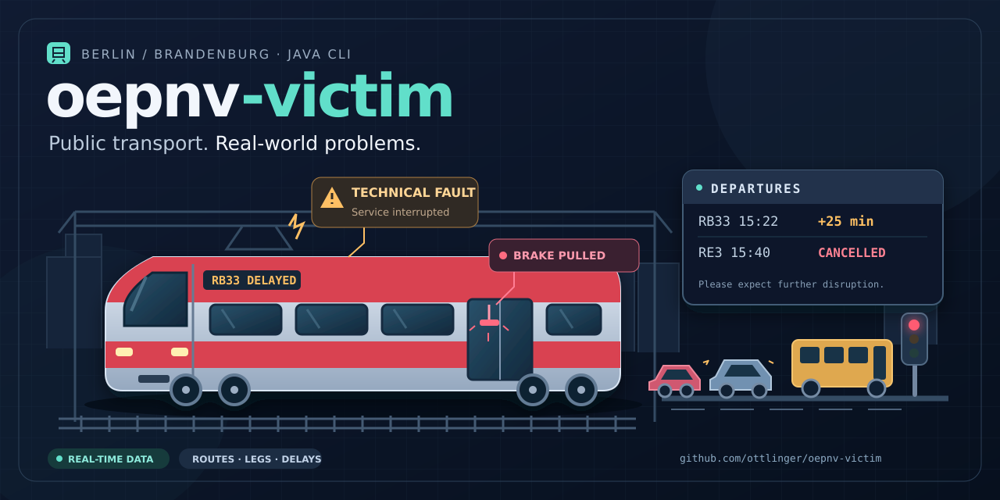

<!-- SPDX-License-Identifier: AGPL-3.0-only -->
# oepnv-victim




[](https://github.com/ottlinger/oepnv-victim/actions/workflows/maven.yml)
[](https://github.com/ottlinger/oepnv-victim/blob/main/.github/dependabot.yml)
[](https://codecov.io/gh/ottlinger/oepnv-victim)

As a vicitim of German public transport you need an easy-to-use tool to get connections.

A Java command-line application for [BVG](https://www.bvg) journey planning in Berlin and Brandenburg.
The origin and destination are configurable; each journey is displayed with its
individual legs.

Created with the help of AI.

The [project artwork](docs/README.md) includes editable SVG sources and PNG exports
of the logo and GitHub social preview.

## Requirements and build


- [Java](https://java.sun.com) 17 or later
- [Maven](https://maven.apache.org) 3.9 or later
- Internet access

```sh
./mvnw
```

## Usage

```sh
java -jar target/oepnv-victim.jar \
  --from "Treuenbrietzen, Bahnhof" \
  --to "Jüterbog, Bahnhof"
```

Additional options:

```sh
# Display only two journeys from the first page of results
java -jar target/oepnv-victim.jar --from "Treuenbrietzen, Bahnhof" --to "Jüterbog, Bahnhof" --limit 2

# Search for journeys departing on 7 November 2026 at 15:22 (Berlin local time)
java -jar target/oepnv-victim.jar \
  --from "Treuenbrietzen, Bahnhof" \
  --to "Jüterbog, Bahnhof" \
  --departure "2026-11-07 15:22"

# Search for journeys arriving on 7 November 2026 at 16:00 (Berlin local time)
java -jar target/oepnv-victim.jar \
  --from "Treuenbrietzen, Bahnhof" \
  --to "Jüterbog, Bahnhof" \
  --arrival "2026-11-07 16:00"

# Travel via an intermediate station
java -jar target/oepnv-victim.jar \
  --from "Treuenbrietzen, Bahnhof" \
  --to "Jüterbog, Bahnhof" \
  --via "S Potsdam Hauptbahnhof" \
  --departure "2026-11-07 15:22"

# Travel via an intermediate station with a requested arrival time
java -jar target/oepnv-victim.jar \
  --from "Treuenbrietzen, Bahnhof" \
  --to "Jüterbog, Bahnhof" \
  --via "S Potsdam Hauptbahnhof" \
  --arrival "2026-11-07 18:00"

# Output all detail fields supplied by BVG as a JSON array
java -jar target/oepnv-victim.jar --from "Treuenbrietzen, Bahnhof" --to "Jüterbog, Bahnhof" --json

java -jar target/oepnv-victim.jar --help
```

`--from` (origin station) and `--to` (destination station) are required parameters.

**Station names must be unambiguous.** The tool resolves the origin, destination and optional
intermediate station using the BVG station search. If a name matches several stations and there is no unique exact
match, it stops and prints a list of possible stations returned by that search to
stderr (exit code `1`); it does not simply select the first result. Run the command
again using the full name of the intended station from the list, for example
`--to "Jüterbog, Bahnhof"` rather than a broad search such as `--to "Jüterbog"`.

`--via` optionally requires a journey through one intermediate station. The same
unambiguous-name rules apply as for `--from` and `--to`. Without `--via`, journeys
are searched as before.

The BVG endpoint does not honour the tested via parameter, so the tool plans two
sections: `from → via` and `via → to`. For each of the first N journeys to the
intermediate station, it searches for an onward journey from the arrival time,
including any reported arrival delay, and selects the first result departing no
earlier than that arrival. Searches crossing midnight use the next day's date.
The output combines both sections and includes waiting time in the total duration;
the resolved intermediate station is also displayed. No additional minimum transfer
time or stopover duration is imposed, and this is not a globally optimised
end-to-end journey search. Allow sufficient time for transfers and check live
service information. If no onward journey is available on the returned page, that
candidate is omitted. Via searches make an additional station lookup and up to N
additional journey requests.

With `--arrival`, planning runs backwards: for each of the first N journeys from
`via → to` arriving at the requested time, the tool searches `from → via` with
arrival no later than the onward departure. It selects the feasible journey with
the latest arrival at the intermediate station, accounting for reported delays.
The preceding search time is rounded down to whole minutes; dates may cross
midnight. Candidates without a feasible preceding journey are omitted. The same
transfer-time and optimisation limitations described above apply.

For `--json`, combined journeys contain `via`, a combined `summary` and `legs`,
and a `viaConnections` array preserving both original BVG journey objects and all
their fields. No synthetic BVG journey ID is assigned.

`--limit` restricts the output to at most N journeys from the first page of results
(default: 5). No further pages are fetched.
`--timeout` sets the timeout for each HTTP request in seconds (default: 30).
`--departure` optionally sets the departure date and time; `--arrival` instead
sets the requested arrival date and time at the destination. Both use the
strict format `YYYY-MM-DD HH:mm`, for example `"2026-11-07 15:22"`. Quote the value
because it contains a space. It is interpreted as local time in Berlin
(`Europe/Berlin`), not the time zone of the computer running the CLI. Invalid dates,
times and formats are rejected with exit code `2` before any network request.
`--departure` and `--arrival` are mutually exclusive; specifying both is rejected
with exit code `2` before any network request. If neither is specified, the search
uses **departure now**.

The search includes all modes of transport from the example URL and real-time
data. Times are local BVG timetable times; missing delay data is not interpreted
as evidence that a service is on time.

Example journey (times and platforms vary; CLI output remains in German):

```text
Verbindung 1: 2026-11-07 12:29 (+0 Min.) → 2026-11-07 12:47 (+0 Min.) | 18 Min.
  1. RB33 Richtung Jüterbog, Bahnhof
     2026-11-07 12:29 (+0 Min.)  Treuenbrietzen, Bahnhof (Gl. 2)
     2026-11-07 12:47 (+0 Min.)  Jüterbog, Bahnhof (Gl. 3)
     Dauer: 18 Min.
     Halte (BVG): 3
```

Departure dates and times are shown in **bold** in both the journey summary and
its individual legs when ANSI styling is enabled. Arrival times and delay
information remain unstyled. Picocli detects terminal support automatically;
redirected output remains plain text by default. Styling can be forced with
`-Dpicocli.ansi=true` or disabled with `-Dpicocli.ansi=false` (place the option
before `-jar`). The plain-text example above does not show terminal styling.

Notices and disruptions are displayed where available. `--json` outputs only the selected journey objects,
including every field supplied by BVG, without terminal styling.

Exit codes: `0` for a successful query (including an empty result list), `1` for a
query error, and `2` for invalid arguments. Error messages are written to stderr.

## HTML and journey details

The HTML initially served by this BVG page contains **no journey results**.
The contents of the expandable details panel are also rendered on the client.
Simply parsing visible HTML elements therefore provides no journey data.

The application handles this without executing JavaScript:

1. Java's `HttpClient` fetches the parameterised journey-planning page.
2. **Jsoup** parses the HTML and reads the embedded `script#__NEXT_DATA__`.
3. The BVG search endpoints are extracted from this configuration.
4. The stop search resolves names to current BVG IDs; IDs from the example URL
   are not hard-coded.
5. The journey endpoint returns the summary and `legs` (individual journey legs).
   These data underpin the expanded details panel in the user interface:
   there is no need to click the details button.

The BVG web endpoints are not guaranteed to be a stable API. If the HTML
configuration or response schema changes, the CLI reports an error. It does not
bypass access restrictions; please keep queries moderate and observe BVG's terms
of use. Intermediate stops are displayed only to the extent that they are
included in the response; the example route currently returns a stop count,
not a list of all intermediate stops.

## Tests

```sh
./mvnw test

# Run tests, build the JAR and enforce the coverage thresholds
./mvnw clean verify
```

JaCoCo requires at least **80% line coverage and 80% branch coverage** across the
project during Maven's `verify` phase. The build fails if either threshold is
missed; the GitHub Actions build also enforces these checks. No production classes
are excluded. The HTML report is available at `target/site/jacoco/index.html`,
and the XML report uploaded to Codecov is generated at `target/jacoco/jacoco.xml`.

The tests run without accessing external BVG services: a local HTTP test server
checks the workflow from HTML parsing to the details query. Further tests cover
name resolution, UTF-8 and URL parameters, error cases, journey legs, platforms,
delays, walking transfers, journeys crossing midnight, notices, terminal styling,
configured departure and arrival times, mutually exclusive time options,
intermediate stations, forward and backward journey planning, CLI validation,
text and JSON output, query errors, and interruption handling.
